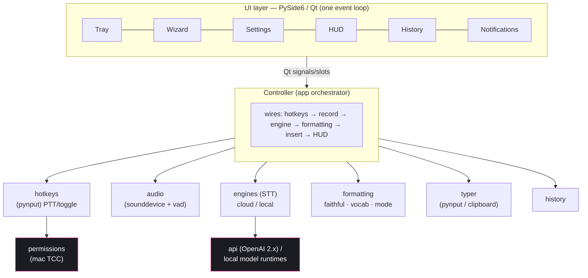
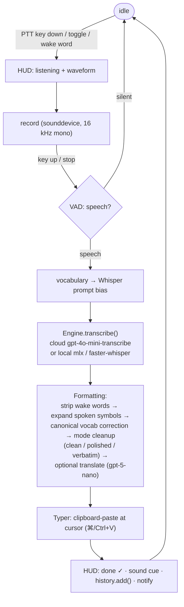
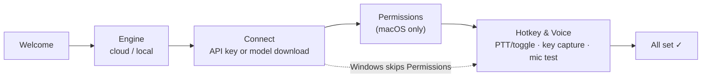

<div align="center">

# 🎙️ Yapper

**Push-to-talk dictation that types what you actually said — for prompting AI agents, writing docs, or just messaging.**

Keeps your words (and your jargon) intact — *never reworded*. Record your voice, transcribe it, fix only the mechanics, and paste it at your cursor.
Cross-platform: **macOS (Apple Silicon)** and **Windows**, one codebase.

`© 2026 Cloudelipute` · MIT License · v4.0.0

</div>

---

## ✨ Features

| | |
|---|---|
| 🎯 **Push-to-talk** | Hold a key to dictate. Toggle and wake-word modes too. |
| 🎯 **Faithful, never reworded** | Types your *actual* words — wording, tone, slang **and** jargon/code kept **verbatim**, never paraphrased. Say "*um so like i'll be there in ten*" and it stays your sentence; say "*cube cuttle apply dash f deployment dot yaml*" and you get `kubectl apply -f deployment.yaml`. |
| 🎚️ **Output modes** | **Clean** (default — faithful: fix only caps/punctuation + fillers, keep your words) · **Polished** (opt-in tidy rewrite) · **Verbatim** (raw, no AI). |
| 🔤 **Spoken symbols** | "dash dash help" → `--help`, "dot py" → `.py`, "open paren" → `(`. |
| 📚 **Vocabulary** | Teach it your terms: "cube cuttle" → `kubectl`, "next J S" → `Next.js`. CSV import. |
| ☁️ **Cloud or 🖥️ on-device** | Default cloud `gpt-4o-mini-transcribe`; optional local `mlx-whisper`/`faster-whisper`. |
| 🪟 **Recording HUD** | Frameless always-on-top pill with live waveform and idle→listening→transcribing→done states. |
| ⌨️ **Unicode-safe paste** | Clipboard-paste primary (⌘/Ctrl+V), `pynput` type fallback — emoji & CJK safe. |
| 🔔 **Native notifications** | Cross-platform toasts; HUD is the always-on fallback. |
| 🔑 **BYOK** | Your OpenAI key, your machine. No telemetry, no middleman. |

---

## 🏗️ Architecture

> 📐 **Full architecture drawings** — system overview, threading model, dictation sequence, engine abstraction, and the formatting pipeline — are in **[docs/ARCHITECTURE.md](docs/ARCHITECTURE.md)**.



## 🔄 Dictation lifecycle



## 🚀 Onboarding flow



---

## 📦 Install (clone-first)

Yapper installs from source with [**uv**](https://docs.astral.sh/uv/). No Python install dance, no embedded runtime.

**Prerequisite:** install `uv` once —

```bash
# macOS / Linux
curl -LsSf https://astral.sh/uv/install.sh | sh
```
```powershell
# Windows (PowerShell)
powershell -ExecutionPolicy ByPass -c "irm https://astral.sh/uv/install.ps1 | iex"
```

### macOS (Apple Silicon)
```bash
git clone https://github.com/romiteld/yapper.git
cd yapper
./setup          # uv sync — creates .venv, installs deps (+ macOS pyobjc helpers)
./run.command    # or ./run.sh
```

### Windows
```bat
git clone https://github.com/romiteld/yapper.git
cd yapper
setup.bat
run.bat
```

### Linux (best-effort)
```bash
git clone https://github.com/romiteld/yapper.git
cd yapper
./setup
./run.sh
```
> Linux is best-effort: global hotkeys need X/uinput and tray support varies by desktop. Not a release target.

### On-device transcription (optional)
```bash
uv sync --extra local   # mlx-whisper on macOS arm64, faster-whisper on Windows/Linux
```

### Prebuilt releases (unsigned)
Unsigned `.app`/`.dmg` (macOS) and `.zip` (Windows) are attached to GitHub Releases as a convenience.
On macOS Sequoia/Tahoe, clear the quarantine flag on first launch:
```bash
xattr -dr com.apple.quarantine /Applications/Yapper.app
```
(or System Settings → Privacy & Security → **Open Anyway**). Notifications may be unavailable on the unsigned build — the HUD covers all feedback.

---

## 🕹️ Using it

- **Dictate:** hold your hotkey (push‑to‑talk), speak, release — the text is pasted at your cursor. Toggle and wake‑word activation are selectable too.
- **Menu‑bar / tray:** quick‑toggle the **engine** (cloud/local), **output mode** (Clean/Polished/Verbatim), and **language** inline; open **Settings** or **History**; quit.
- **Settings** (sidebar): General · Engine & Models · **Vocabulary** (teach it your terms) · **Formatting** (mode + spoken symbols) · Hotkeys · Audio · History · About. Edits apply on **Save**.
- **History:** search past dictations, copy, re‑insert, **reprocess** with current settings, clear, or export.
- **Scripted / no GUI:** `uv run python -m app --once` does a single record→type; `--seconds N` sets the recording window.

📐 See **[docs/ARCHITECTURE.md](docs/ARCHITECTURE.md)** for the full architecture drawings (system overview, threading model, dictation sequence, engine abstraction, formatting pipeline, and the UI‑surface map).

---

## 🔐 Permissions (macOS)

macOS only re-reads permissions **at process start** — after granting anything, **quit & relaunch Yapper**.

| Permission | Why | How |
|---|---|---|
| 🎤 **Microphone** | Record your voice | OS prompts on first capture |
| ♿ **Accessibility** | Paste / type at the cursor | System Settings → Privacy & Security → Accessibility → enable Yapper |
| ⌨️ **Input Monitoring** | Capture the push-to-talk hotkey | System Settings → Privacy & Security → Input Monitoring → enable Yapper |

Grant these to the **Yapper app's identity** (the `.app`, or your terminal/Python when running from source). Without Accessibility, key injection **fails silently** — the first-run wizard detects and guides you through it.

Windows and Linux require no special TCC grants (Windows hotkeys may need an elevated terminal in some configurations).

---

## 🤖 Models & cost

| Role | Default | Alternative | Notes |
|---|---|---|---|
| Cloud STT | `gpt-4o-mini-transcribe` (~$0.003/min) | `whisper-1` | mini is ~50% cheaper & more accurate; whisper-1 kept for long-tail langs / timestamps |
| On-device STT | `mlx-whisper` (mac) / `faster-whisper` (win) | size selectable (`base`…) | runs offline; install via `--extra local` |
| Text cleanup / translate | `gpt-5-nano` (`reasoning_effort='minimal'`) | `gpt-5.4-nano` | drives **Clean**/**Polished** modes + translation; `gpt-4.1-nano` is **deprecated** (shuts down 2026-10-23) |

**Output modes** (`output_mode` setting): **Clean** (default) faithfully fixes only caps/punctuation and fillers while keeping your exact words, tone, and any code/jargon verbatim. **Polished** is an opt-in heavier rewrite into tidy prose. **Verbatim** makes no AI call at all (the deterministic spoken-symbol + vocabulary stages still run, so it works with no API key).

A few minutes of dictation per day on the cloud default costs cents. On-device is free after download.

---

## 🔑 BYOK & privacy

Yapper is **bring-your-own-key**. You paste your own OpenAI API key during onboarding; it is stored locally in `app/settings.json` (gitignored) and used only to call OpenAI directly from your machine.

- **No telemetry.** Yapper phones home to nothing.
- **No middleman.** Audio and text go straight from your machine to the API you chose.
- **Local-only option.** With `--extra local`, transcription never leaves your device.
- **Your key, gitignored.** `app/settings.json` is never committed.

---

## 🛠️ Development

```bash
uv sync --extra dev     # pytest, pytest-qt, pyinstaller
uv run pytest           # run the test suite
uv run python -m app    # run from source
```

---

<div align="center">

`© 2026 Cloudelipute` · Released under the [MIT License](LICENSE).

</div>
