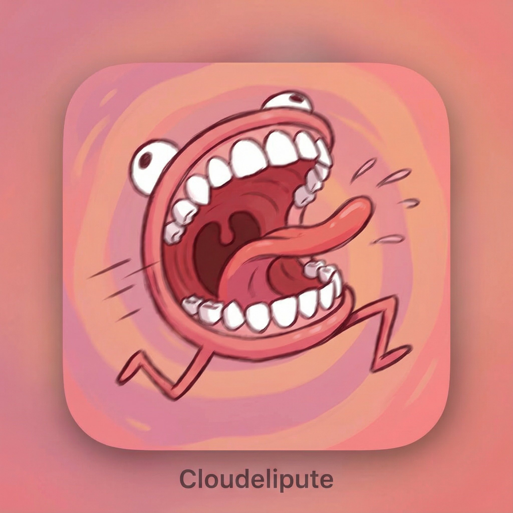

# Yapper - Speech to Text

<p align="center">
  
</p>

**Yapper** is a portable speech-to-text application that transcribes your voice and types the text wherever your cursor is positioned. Powered by OpenAI's Whisper and GPT-4.1-nano.

## Features

- **Voice Activation**: Say "Yapper start" to begin, "Yapper stop" to end
- **Hotkey Control**: Press F8 (configurable) to start/stop recording
- **Translation**: Speak in any language, output in 40+ languages
- **Grammar Correction**: Automatic grammar and punctuation fixes
- **Voice Activity Detection**: Reduces API costs by skipping silent recordings
- **System Tray Mode**: Runs quietly in background
- **Cross-Platform**: Windows, macOS, and Linux support

---

## Quick Start (Windows Portable)

### Download Ready-to-Use Version

1. Download the latest release from [Releases](https://github.com/romiteld/yapper/releases)
2. Extract the zip anywhere
3. Run `First Run.bat` to set up your API key
4. Run `Yapper.bat` to start!

### Get an API Key

You need an OpenAI API key: https://platform.openai.com/api-keys

---

## Installation (From Source)

### Windows

```batch
git clone https://github.com/romiteld/yapper.git
cd yapper
INSTALL.bat
Settings.bat
Yapper.bat
```

### macOS

```bash
git clone https://github.com/romiteld/yapper.git
cd yapper
./install.sh
./run.sh settings
./run.sh
```

### Linux

```bash
git clone https://github.com/romiteld/yapper.git
cd yapper
./install.sh
./run.sh settings
sudo ./run.sh  # Requires root for global hotkeys
```

---

## Usage

### Voice Commands (Tray Mode)
- **"Yapper start"** - Begin recording
- **"Yapper stop"** - Stop and transcribe

### Hotkey (Default: F8)
1. Click where you want the text
2. Press F8 to start recording
3. Speak clearly
4. Press F8 to stop and transcribe

### System Tray Menu
Right-click the tray icon to:
- Change output language
- Toggle grammar correction
- Toggle voice activity detection
- Open settings

---

## Building Portable Version

To create a distributable portable package:

1. On Windows, run:
   ```
   BUILD_PORTABLE.bat
   ```

2. Find the zip in the `dist/` folder

3. Share the zip - users just extract and run!

---

## Configuration

Settings are stored in `app/settings.json`:

| Setting | Description |
|---------|-------------|
| `api_key` | Your OpenAI API key |
| `hotkey` | Recording hotkey (f8, f9, f10, etc.) |
| `translate_to` | Output language code (es, fr, de, etc.) |
| `fix_grammar` | Auto-correct grammar (true/false) |
| `vad_enabled` | Voice activity detection (true/false) |
| `wake_word_fuzzy` | Fuzzy wake word matching (true/false) |

---

## Requirements

- OpenAI API key
- Python 3.8+ (not needed for portable version)
- Microphone

### Dependencies
- openai
- keyboard
- pyaudio
- pystray
- Pillow
- customtkinter

---

## Troubleshooting

### PyAudio Installation Issues

**Windows:**
```
pip install pipwin
pipwin install pyaudio
```

**macOS:**
```
brew install portaudio
pip install pyaudio
```

**Linux:**
```
sudo apt install python3-pyaudio portaudio19-dev
```

### Hotkey Not Working (Linux)
Run with sudo: `sudo -E ./run.sh`

### No Microphone Detected
Check Settings to select a specific microphone device.

---

## Project Structure

```
yapper/
├── app/
│   ├── core/           # Shared modules
│   │   ├── api.py      # OpenAI client with retry
│   │   ├── audio.py    # Audio recording
│   │   ├── vad.py      # Voice activity detection
│   │   └── ...
│   ├── yapper.py       # Console mode
│   ├── yapper_tray.py  # System tray mode
│   └── settings_ui.py  # GUI settings
├── Yapper.bat          # Windows launcher
├── run.sh              # macOS/Linux launcher
└── BUILD_PORTABLE.bat  # Create portable distribution
```

---

## License

Copyright (c) 2026 Cloudelipute

---

## Support

- Issues: https://github.com/romiteld/yapper/issues
- API Keys: https://platform.openai.com/api-keys
