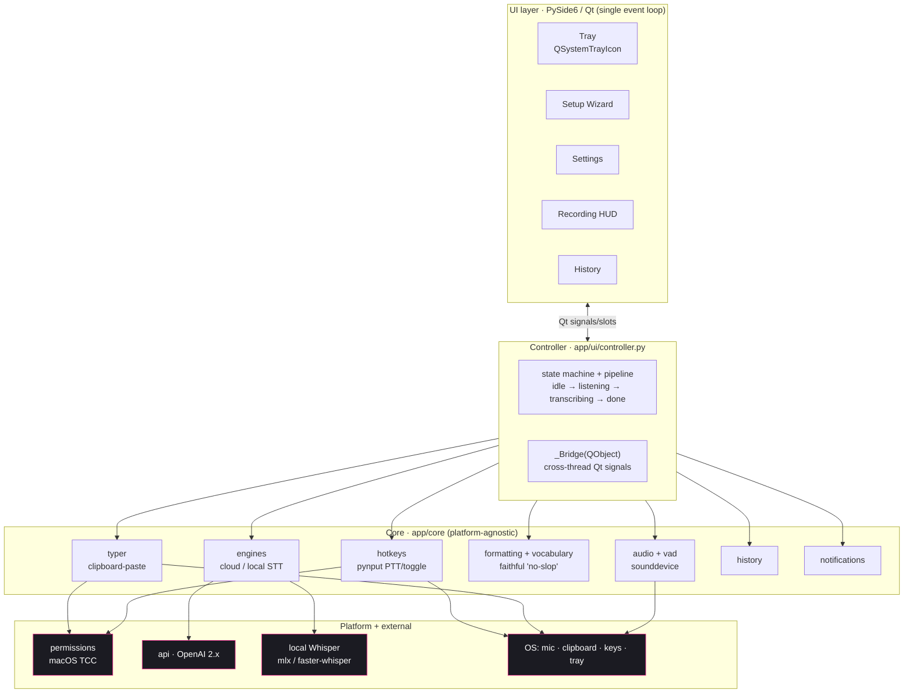
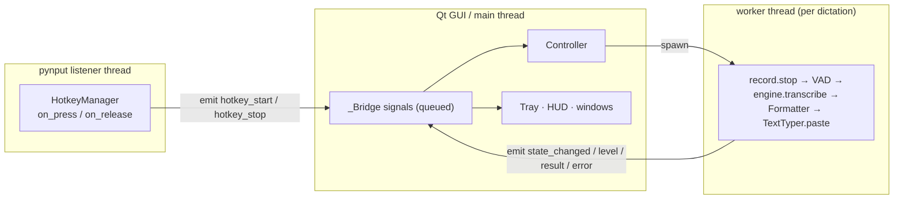
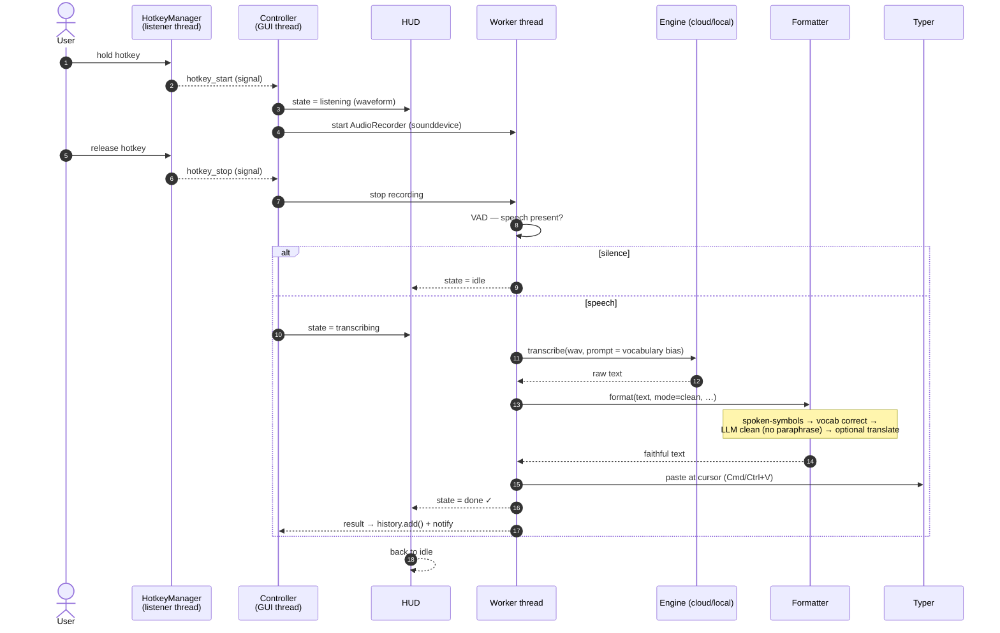
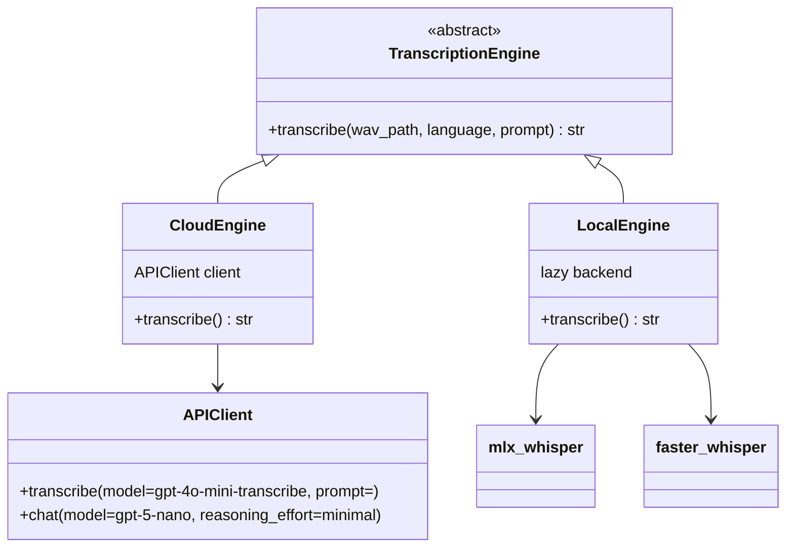
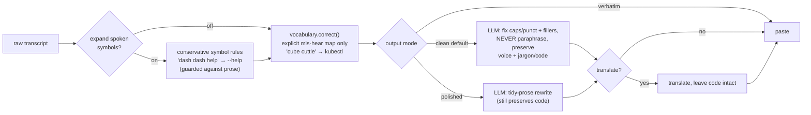
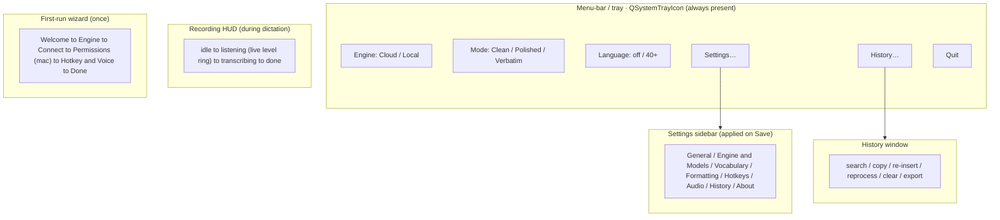

<div align="center">

# Yapper — Architecture

Cross‑platform push‑to‑talk dictation. One codebase runs on macOS (Apple Silicon) and Windows.
PySide6/Qt owns a single event loop; platform differences are isolated behind thin abstractions.

</div>

---

## 1. System overview

Layered: a Qt **UI layer** talks to a headless **Controller**, which orchestrates the **core** modules. The core is platform‑agnostic; only `hotkeys`, `permissions`, `typer`, `notifications`, and `platform` touch OS‑specific APIs, and each degrades gracefully off its native platform.



---

## 2. Threading model

The single most important design constraint. Three threads cooperate; **all** cross‑thread communication goes through `_Bridge` Qt signals (queued), so no widget is ever touched off the GUI thread, and the blocking transcription/API call never freezes the UI.



**Rules enforced in code**
- Hotkey callbacks (background thread) only `emit()` signals — never call Controller/Qt directly.
- Recording + the network/transcription call run on a worker thread, so the GUI never blocks.
- Widget mutation happens only on the GUI thread, driven by queued signals.

---

## 3. Dictation lifecycle

Push‑to‑talk: hold the key, speak, release. The result is pasted at the cursor.



---

## 4. Transcription engine abstraction

Cloud and on‑device engines share one interface, selected at runtime from settings. Default is cloud; on‑device is an optional install (`uv sync --extra local`).



`get_engine(settings)` returns the configured engine (raises on unknown names). The vocabulary's `whisper_prompt()` is passed as the transcription `prompt=` bias to improve accuracy on names/terms.

---

## 5. The faithful formatting pipeline ("no slop")

The product promise: type what you actually said — your wording, voice, and slang **and** any jargon/code — and never reword it. Cleanup fixes only mechanics.



Deterministic stages (symbols, vocabulary) are tuned so casual speech passes through **unchanged** — e.g. "i use pnpm instead of npm" and "the dot product" are never rewritten — while CLI/code dictation still converts.

---

## 6. UI surfaces & actions

What the user actually sees and clicks. The menu‑bar/tray is the always‑present control; the wizard runs once; settings/history open on demand; the HUD appears only during dictation.



- **Tray quick toggles** flip engine / output mode / language inline and persist immediately; everything else lives in **Settings**, where edits are buffered and applied only on **Save** (close‑without‑save discards).
- **No GUI required:** `python -m app` runs the tray app; `python -m app --once [--seconds N]` does a single scripted record→type with no tray/HUD.

---

## 7. Package layout

```
app/
├── __main__.py            # python -m app → cli → ui.app.main()  (--once for scripted single-shot)
├── cli.py
├── core/                  # platform-agnostic logic (heavily unit-tested)
│   ├── hotkeys.py         # pynput PTT / toggle / wake-word + auto-repeat guard
│   ├── permissions.py     # macOS TCC detection (no-op True off-mac)
│   ├── typer.py           # clipboard-paste primary, pynput type fallback
│   ├── audio.py/devices.py# sounddevice capture + device enumeration
│   ├── vad.py             # voice-activity detection
│   ├── notifications.py   # desktop-notifier wrapper
│   ├── platform.py        # IS_MAC/IS_WIN, default hotkey, settings deep-links
│   ├── engines/           # base · cloud · local · get_engine()
│   ├── formatting.py      # Clean/Polished/Verbatim + spoken symbols
│   ├── vocabulary.py      # Whisper bias + fuzzy mis-hear correction
│   ├── transcriber.py     # orchestrates engine + formatter
│   ├── api.py             # OpenAI 2.x client (retry)
│   ├── config.py/constants.py
│   └── sounds.py · history.py · logger.py
└── ui/                    # PySide6
    ├── app.py             # YapperApp · QSystemTrayIcon · _Bridge · main()
    ├── controller.py      # headless state machine + pipeline
    ├── hud.py             # frameless always-on-top recording pill
    ├── wizard.py          # first-run setup (Permissions step macOS-only)
    ├── settings_window.py # sidebar settings
    ├── history_window.py  # searchable history
    └── theme.py           # dark QSS, accent #ec2a8e
```

---

## 8. Key design decisions

- **One Qt event loop** (PySide6) for tray + HUD + wizard + settings, avoiding the macOS main‑thread contention that a separate tray library would create.
- **`pynput`** for both global hotkey capture **and** keystroke/paste injection, cross‑platform (replaced the Windows‑only `keyboard`).
- **Clipboard‑paste insertion** (⌘/Ctrl+V) as the primary path — Unicode/emoji/CJK‑safe — with `pynput` typing as a fallback.
- **`sounddevice`** for audio (bundles PortAudio in its wheels, removing the macOS PyAudio build problem).
- **Engine interface** so cloud and on‑device transcription are interchangeable; cloud default keeps the base install light.
- **Faithful formatting** with deterministic, conservative text transforms plus a strict no‑paraphrase LLM prompt.
- **Clone‑first** distribution via `uv`; unsigned `.app`/`.dmg`/`.zip` attached to Releases as a convenience.

## 9. Cross-platform notes

| Concern | macOS | Windows |
|---|---|---|
| Hotkeys / typing | needs Accessibility + Input Monitoring (detected, guided; fails silently otherwise) | works without special grants |
| Microphone | `NSMicrophoneUsageDescription` prompt | OS prompt |
| Notifications | Notification Center (signed builds) — HUD is the always‑on fallback | WinRT toasts |
| Tray | `QSystemTrayIcon` | `QSystemTrayIcon` |
| First launch (unsigned) | `xattr -dr com.apple.quarantine` or Open Anyway | run normally |
